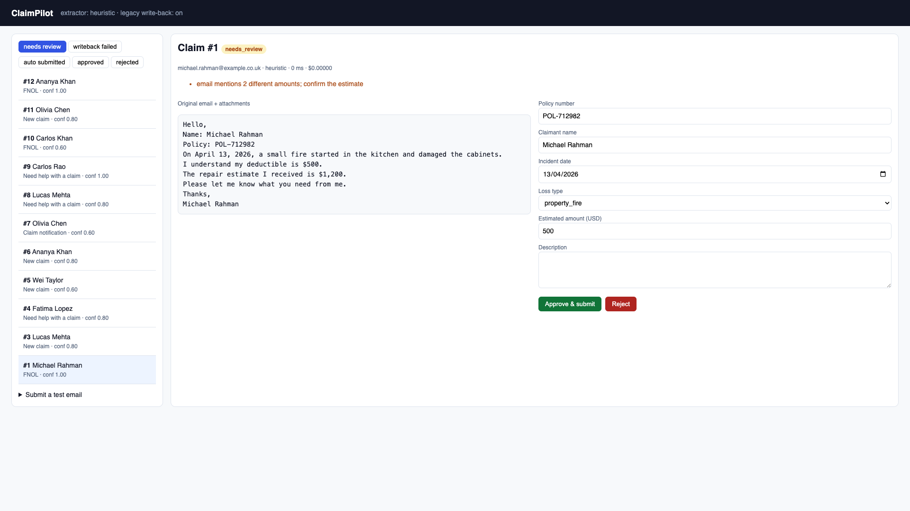
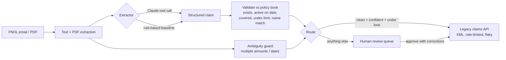

# ClaimPilot

**Live demo:** https://claimpilot-dma5.onrender.com (free tier; the first load after idle takes ~1 minute)

**AI intake for insurance claims.** ClaimPilot reads first-notice-of-loss (FNOL) emails and PDF forms, extracts the claim, checks it against the policy book, auto-submits the safe ones to the carrier's legacy claims system, and sends everything else to a human with the reason highlighted.



*The rule-based baseline pulled the $500 deductible instead of the $1,200 estimate. Every field was filled in, so a confidence check alone would have let it through. The ambiguity guard caught it and sent it to a human.*

---

## The problem (as a carrier would describe it)

A claims team receives FNOL emails in every shape: free text, forwarded forms, attached PDFs. A handler re-keys policy number, claimant, loss date, loss type, and estimate into a legacy system. It's slow, and the errors are expensive: a wrong loss date can push a claim outside the policy period.

**Goal for a pilot:** automate intake for clean claims with **zero wrong auto-submissions**, and make every human review faster by showing exactly what to check.

## How it works



| Piece | What it does | Where |
|---|---|---|
| Extractors | `claude` uses forced structured output (a tool call with a JSON schema) on `claude-haiku-5-5`. `heuristic` is a regex baseline that needs no API key | `app/extract/` |
| Validation | Policy exists, incident inside policy period, loss type covered, amount within limit, claimant matches holder | `app/validate.py` |
| Ambiguity guard | Deterministic check: more than one amount or date in the email means a human confirms | `app/guards.py` |
| Routing | Never auto-rejects. Auto-submits only when there are no issues, confidence ≥ 0.8, and amount ≤ $5,000 | `app/routing.py` |
| Legacy write-back | XML client with retries, exponential backoff, `Retry-After`, and **idempotency keys** | `app/legacy_client.py` |
| Mock legacy system | XML-only, rate-limited, fails 20% of the time, and half of those failures happen *after* saving | `legacy_api/main.py` |
| Review UI | Queue by status, original email next to editable fields, approve or reject | `app/static/review.html` |
| Evals | 80 generated FNOL emails with ground truth and realistic traps, scored per field and per routing outcome | `evals/` |

## Results

80 eval cases (`evals/data/cases.jsonl`). About 30% mention a deductible before the estimate, 30% mention the policy start date before the loss date, and some describe the loss without obvious keywords ("the upstairs bathroom overflowed").

**Rule-based baseline** (`python -m evals.run --extractor heuristic`):

| Field | Accuracy |
|---|---|
| policy_number | 100.0% |
| claimant_name | 100.0% |
| incident_date | 58.8% |
| loss_type | 45.0% |
| estimated_amount | 37.5% |
| **all 5 fields correct** | **6.2%** |

| Routing | Auto-submitted | Auto-submitted with a wrong field |
|---|---|---|
| Without ambiguity guard | 25 / 80 | **23** |
| With ambiguity guard | 2 / 80 | **0** |

The guard is what makes the system safe to pilot. Without it, 23 of the 25 claims the baseline would auto-submit carry a wrong value, even though validation passed. With it, nothing wrong gets through, but almost nothing is automated. The LLM extractor's job is to raise the automation rate while keeping the wrong-submission count at zero.

**Claude extractor** (`ANTHROPIC_API_KEY=... python -m evals.run --extractor claude`): *results go here after the first run (accuracy, automation rate, cost per claim, latency).*

## Engineering decisions worth discussing

- **Confidence is capped by completeness.** A model's self-reported confidence is unreliable, so ClaimPilot uses `min(model confidence, share of required fields present)`.
- **Deterministic guards on top of the model.** Cheap checks catch the failure mode that matters most: a complete, plausible, wrong extraction.
- **Idempotency keys on write-back.** The mock legacy system sometimes saves a claim and then returns a 500. A naive retry creates a duplicate claim; the same `X-Idempotency-Key` on every retry returns the original reference instead. `tests/test_legacy.py` proves 30 claims through a 60% failure rate produce exactly 30 records.
- **Never auto-reject.** Denying a claim is a regulated decision; the system only routes to a human.
- **Extraction failures don't lose claims.** If the model API is down, the claim is stored and queued for review with the error as the reason.

## Run it

```bash
uv venv --python 3.12 .venv && uv pip install --python .venv/bin/python -r requirements-dev.txt
.venv/bin/python -m pytest -q                 # 25 tests

# terminal 1: the flaky legacy system
.venv/bin/uvicorn legacy_api.main:app --port 9000
# terminal 2: ClaimPilot (add ANTHROPIC_API_KEY to use Claude)
LEGACY_API_URL=http://127.0.0.1:9000 .venv/bin/uvicorn app.main:app --port 8000
open http://localhost:8000
```

With Docker: `docker compose up --build` (Postgres + legacy mock + app on :8000).

### Deploy (Render, free tier)

`render.yaml` defines the app, the mock legacy system (same image, `APP_MODULE=legacy_api.main:app`) and Postgres.

1. Render dashboard → **New → Blueprint** → pick this repo → **Apply**. Leave `LEGACY_API_URL` and
   `ANTHROPIC_API_KEY` empty for now.
2. When `claimpilot-legacy` is live, copy its URL into `claimpilot` → Environment → `LEGACY_API_URL`.
3. Optional: set `ANTHROPIC_API_KEY` to switch from the rule-based extractor to Claude. The demo is public, so set a
   monthly spend limit in the Anthropic console first.
4. Check `https://<claimpilot-url>/health` shows `"legacy_writeback": true`.

Free services sleep after ~15 minutes idle; open both URLs a minute before a demo. A claim whose write-back fails
during a cold start shows as `writeback_failed` and can be re-approved from the queue.

### API

| Method | Path | Purpose |
|---|---|---|
| POST | `/claims/intake` | `{sender, subject, body}` JSON email |
| POST | `/claims/intake/upload` | multipart: `sender`, `subject`, `body`, `file` (PDF or text) |
| GET | `/claims?status=needs_review` | queue |
| GET | `/claims/{id}` | one claim |
| POST | `/claims/{id}/approve` | `{corrections: {...}}` optional; writes back to legacy |
| POST | `/claims/{id}/reject` | reject |
| GET | `/health` | active extractor and write-back status |

## What I'd do next with a real carrier

1. Replace the generated eval set with 200 real, anonymized historical FNOLs and their final adjusted values.
2. Image attachments (photos of handwritten forms) via Claude vision.
3. Track reviewer edits as labels: every correction becomes a new eval case.
4. Relax the guard per field once evals show the model resolves that ambiguity reliably, and measure the automation gain.
